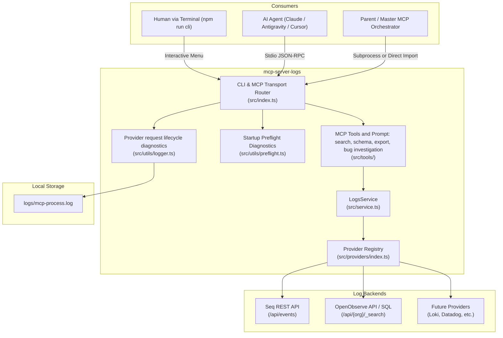
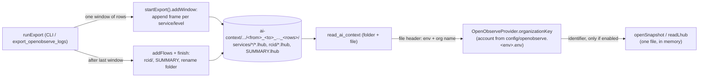
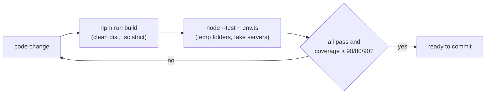

# Architecture & Design Overview

## 1. System Topology

`mcp-server-logs` operates as a unified adapter layer bridging AI Agent interfaces and heterogeneous logging platforms.



On connect, the server sends instructions (`logsInstructions()` in `src/tools/index.ts`): agents in any repository learn to read ai-context only through `read_ai_context`, in which order, and to compare logs with their own source. The `analyze_ai_context` MCP Prompt packages that workflow for one question. The `investigate_api_bug` MCP Prompt guides the caller through inspecting source code, discovering Organization/stream/schema, running bounded SELECT searches, saving evidence in the caller's own `log-work/` directory, and citing log timestamps with source locations. Provider request logs record endpoint paths, status, duration, and result counts without credentials, query values, or returned application log contents.

---

## 2. Core Architectural Pillars

### Pillar A: Dual-Mode Operation (Standalone vs Embedded Child)
1. **Standalone MCP Server**:
   - Run directly via `node dist/index.js` or `npx mcp-server-logs`.
   - Communicates over standard input/output (`StdioServerTransport`).
2. **Embedded Child Feature Module**:
   - Master MCPs can import `registerLogsTools` and mount log querying capabilities directly into the master server without subprocess overhead.

### Pillar B: Stdio Transport Integrity
In the Model Context Protocol, any data written to standard output (`stdout`) that is not valid JSON-RPC breaks the client connection.
- **Rule**: `process.stdout` is exclusively reserved for `@modelcontextprotocol/sdk`.
- **Diagnostics & Errors**: Routed to `process.stderr` and appended to `logs/mcp-process.log`.
- **Interactive UI**: Only rendered when explicitly started in CLI mode (`--cli`).

### Pillar C: Provider Adapter Pattern
Every log backend implements the common `LogProvider` interface:
```typescript
export interface LogProvider {
  readonly name: string;
  getStatus(): ProviderStatus;
  queryLogs(params: LogQuery): Promise<LogEntry[]>;
}
```
Each provider encapsulates its own authentication, endpoint URL structure, and native query format. OpenObserve also discovers accessible Organizations and log streams.

### Pillar D: Encrypted ai-context Exports
`src/export.ts` (`runExport`, shared by the CLI and the MCP tool) drives one export into one folder through `startExport` in `src/ai-context/export-folder.ts`:
- A range is fetched in windows of at most 250k downloaded rows. The provider pages each window with a time cursor and 5 parallel slices.
- Each window appends one encrypted frame to every `services/<service>/<level>.lhub` file it touches.
- After the last window, the flows of the export's failing requests go to `rcid/`, and SUMMARY / patterns / manifest cover the whole export.

Framework noise is filtered out in SQL and only counted by server-side GROUP BY (`exportAggregates`); request flows keep it. See OPENOBSERVE_GUIDE.md "ai-context exports" and "What an export keeps and what it skips". `src/ai-context/` is the only reader: `lhub.ts` (file format and crypto), `read.ts` (list, open, dedupe), `summary.ts` (SUMMARY text), `model.ts` (lines, patterns, names, windows).

- Each `.lhub` file has a plaintext, authenticated header (env, Organization name, stream, kind) followed by frames. Each frame is Brotli + AES-256-GCM, with key = HKDF(identifier, the file's salt). Folder and file names are plaintext; log content is only inside frames.
- `organizationKey` lists the Organizations of the account saved for the export's env. It returns the identifier only when the Organization is listed, so connecting to the environment without access to that Organization is not enough.
- Organization identifiers are never written to disk; the process log masks them (`maskOrg`).

### Pillar E: Tests as the Safety Net
`npm test` builds, preloads `src/tests/env.ts` (temp `LOG_DIR` / `CONFIG_DIR` / `AI_CONTEXT_DIR`, no accounts) and runs every `src/tests/*.test.ts` with `node:test` and a coverage gate. Providers are tested against fake servers (`src/tests/helpers.ts`), MCP tools through a real client/server pair over `InMemoryTransport`, and the CLI and stdio server in child processes.



---

## 3. Environment Portability
- All file paths (logs, configurations, ai-context) are resolved from `PROJECT_ROOT` (`fileURLToPath(import.meta.url)` + `node:path.resolve`) and can be moved with `LOG_DIR`, `CONFIG_DIR` and `AI_CONTEXT_DIR`.
- No operating system-specific path separators or drive letters are hardcoded.
- Runs identically on Windows (PowerShell/CMD), Linux, macOS, and containerized Docker environments.
